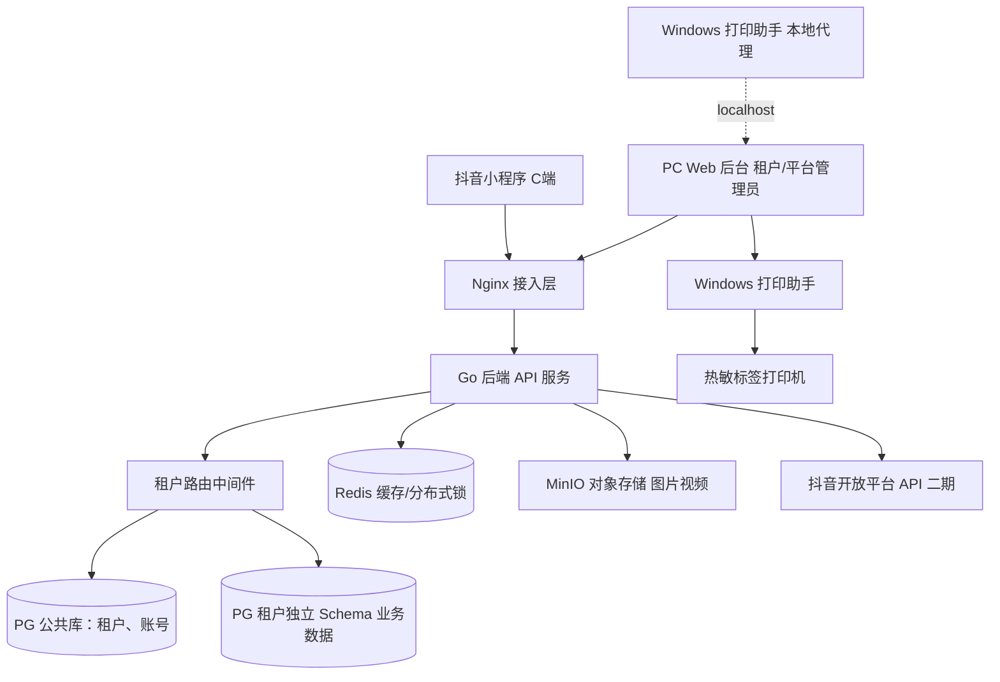

# 宠物商户 SaaS 系统 PRD（最终版）

> 版本：v2.0（已合并原修订稿全部调整意见）
> 项目名称：宠物商户数字化管理 & 抖音生态联动 SaaS
> 面向客户：猫舍、犬舍、宠物繁育基地、宠物店（洗护 / 美容 / 寄养）
> 技术底座：PostgreSQL（一租户一 Schema，方案 B，后期可平滑升级独立数据库 C）、Redis、对象存储（MinIO 起步）
> 配套开发计划见：[plan.md](./plan.md)

## 终端划分

- **PC 桌面 Web 后台**：租户管理、付费、业务配置、单据管理、抖音团购券、打印机管理、自定义业务流程。**所有付费入口仅放在 PC 端，抖音小程序不展示任何付费内容**。
- **抖音小程序（C 端 + 租户轻量发布）**：C 端客户访问入口，展示宠物档案、宠物视频、商家主页、商家其他宠物、咨询卡片；租户可从小程序发布视频并挂载小程序。**摄像头实时画面为增值功能，未开通租户的小程序中完全隐藏该模块**。
- **Windows 打印助手（本地小程序）**：安装在门店 Windows 电脑上的本地代理程序，配合白标热敏标签打印机完成吊牌标签直连打印。
- **硬件配套**：白标无 LOGO 蓝牙 / USB 热敏标签打印机 + PET 防水标签，套餐 499 元（打印机 + 一批贴纸），后续耗材 0.2 元 / 张；支持打印自定义艺术二维码宠物吊牌标签。

## 核心商业模式

499 元基础硬件套餐获客，基础软件全部免费（高级繁育台账免费）；**基础版核心三角 = 高级繁育台账 + 自定义业务工单 + 吊牌标签打印**，以此建立"繁育 + 门店管理 + 宠物身份标识"的垂直赛道差异，而非通用门店管理。

增值收入：实时看宠摄像头增值包、自定义打印模板、抖音团购联动插件、高级报表 / CRM 等按需付费；支持租户裂变入驻。

---

## 1. 产品目标

1. **B 端租户（宠物店 / 猫舍）**：统一管理宠物档案、繁育记录、自定义业务工单（寄养、洗澡、美容等）、客户档案、打印宠物吊牌二维码标签。
2. **C 端客户**：扫码 / 从小程序进入单只宠物页面，查看宠物信息、视频与服务进度；可跳转商家主页浏览该商家全部宠物；发起咨询。**实时摄像头画面仅作为增值体验，不是基础链路**。
3. **抖音生态联动**：租户可发布挂载小程序的短视频；二期对接抖音本地生活团购券，抖音下单购券、门店 PC 后台核销、核销自动生成业务工单。
4. **多租户隔离**：PG 按 Schema 隔离租户数据，Redis 做缓存、分布式锁、API 限流。
5. **灵活扩展**：租户可自助自定义业务流程（登记、订单时长、完成时间、事件触发器），适配不同门店差异化业务。

## 2. 用户角色

1. **平台管理员（平台侧）**：管理全部租户、租户开通、套餐权限、平台大盘、硬件订单。
2. **租户主账号（老板）**：最高权限，自定义业务流程、抖音授权、团购套餐绑定、打印模板配置、子账号管理、购买增值服务。
3. **租户子账号（店员）**：单据录入、宠物登记、团购券核销、标签打印、工单影像上传；权限由主账号分配。
4. **C 端客户（宠物主人 / 意向买家）**：小程序查看宠物资料与服务进度、浏览商家全部宠物、发起咨询。

## 3. 套餐权限设计

**499 元基础硬件套餐：打印机 + 贴纸，基础软件全部免费。**

### 3.1 免费包含（基础版）

- 多租户后台基础管理（子账号与细粒度权限）
- 宠物档案、**高级繁育台账免费**
- **自定义业务流程引擎**（工单：登记、订单持续时间、完成时间、触发器事件）
- 宠物吊牌标签打印，**基础打印模板免费**
- **工单节点推送 + 宠物日常照片 / 10 秒短视频上传**（店员上传到工单，C 端小程序可查看，作为基础版服务进度体验的核心）
- C 端小程序页面：单宠详情、商家主页、全店宠物浏览、视频展示、咨询卡片、门店独立分享
- 小程序挂载发布能力（以平台实际开放权限为准，未获批时功能开关占位）

### 3.2 PC 端增值付费模块（仅 PC 后台可见，小程序无任何付费入口）

1. **实时看宠增值包（摄像头，进阶功能）**：详见第 5 节。
2. 自定义艺术二维码模板、高级标签排版模板（按模板购买）。
3. 抖音本地生活团购券核销联动插件。
4. 高级数据报表、客户 CRM 批量消息推送。

> 权限边界：未开通增值的租户，PC 后台仅保留"摄像头管理"入口占位；C 端小程序不展示任何摄像头相关模块。

## 4. 核心模块详细需求

### 模块 1：多租户管理模块（PC 后台）

**功能描述**

基于 PG Schema 多租户方案，一个租户独立 Schema；平台路由层根据租户上下文自动路由到对应 Schema；后期可平滑迁移至独立数据库（方案 C）。Redis 存储租户登录态、接口缓存、分布式锁。

**功能清单**

1. 租户开通、停用、续费管理（开通时自动创建租户 Schema 并初始化表结构）。
2. 租户信息：门店名称、地址、联系方式、门店独立分享主页。
3. 子账号管理：新增子账号、分配细粒度权限（核销券、打印标签、编辑宠物档案、上传工单影像等）。
4. 套餐权限控制：增值功能全局开关，购买入口仅 PC 端。
5. 租户裂变推广：专属入驻邀请链接，平台配置裂变激励。

**平台公共库表（不属于租户 Schema）**：`tenant`（租户主表）、`tenant_package`（套餐表）、`tenant_user`（租户账号表）。

### 模块 2：宠物 & 繁育档案模块（PC 后台 + C 端小程序）

**功能描述**

租户录入宠物基础信息、品种、年龄、疫苗、驱虫、繁育记录、照片、视频。摄像头绑定**不属于基础功能**，统一收敛到"实时看宠增值包"（第 5 节）。

**PC 后台能力**

1. 宠物档案 CRUD，批量导入宠物资料。
2. 繁育台账：种公种母配对、预产期、幼崽登记、血统记录（高级繁育账免费）。
3. 一键生成宠物吊牌二维码（艺术二维码为增值模板），经 Windows 打印助手调用本地打印机出标签。
4. 宠物视频上传，视频关联对应宠物档案。

**C 端小程序展示**

1. 扫码进入【单只宠物详情页】：基础信息、视频；**摄像头实时画面为增值模块，未开通 / 该宠物未绑定时不展示**。
2. 【返回商家主页】：跳转门店主页，浏览该租户下全部宠物。
3. 商家主页独立分享链接，可单独转发。
4. 咨询卡片：客户一键发起咨询，消息推送至租户后台。

### 模块 3：自定义业务流程引擎（工单系统，PC 后台）

**功能描述**

统一模型：单据登记、订单持续时间、预计完成时间、完成时间、状态变更、触发器事件。租户新增业务类型并自定义表单字段、状态流转、触发事件，无需开发改代码。

**功能清单**

1. 租户新增业务类型，如【宠物寄养】【宠物洗澡美容】。
2. 自定义表单：文本、手机号、日期、多选等字段。
3. 自定义状态流：待登记、进行中、已完成、已取消（可扩展）。
4. 触发器配置：状态变更 / 时间到达自动触发事件。
   - 例：寄养单据创建 → 自动发送**工单确认通知**（**基础版仅推通知；摄像头临时链接为增值版专属触发项**）；单据到期前 3 天提醒客户；标记完成自动归档。
5. 业务单据管理：新建、编辑、查看、归档；审计日志记录全部变更历史。
6. 单据关联宠物档案、客户信息；可上传**宠物服务过程照片 / 10 秒短视频**（基础版）；二期可绑定抖音团购券核销记录。

**租户 Schema 内表**：`tenant_biz_type`（业务类型）、`tenant_biz_record`（工单单据）、`tenant_biz_record_log`（变更审计日志）、`tenant_biz_media`（工单影像）。

### 模块 4：标签打印模块（Windows 打印助手 + PC 后台）

**功能描述**

白标无 LOGO 热敏标签打印机，Windows 安装驱动 + 本地打印助手，免蓝牙协议开发；支持 PET 防水贴纸。

**功能清单**

1. PC 后台选择模板，渲染标签内容：宠物名称、电话、二维码、备注。
2. 基础模板免费；高级自定义排版 / 艺术二维码模板增值付费（二期上线商店，一期仅预留计费位）。
3. 批量打印、单张打印。
4. 标签模板管理：租户保存自有模板。
5. 耗材库存记录：贴纸消耗登记与耗材复购入口（PC 端）。

**实现思路（详见 plan.md 技术方案）**：Go 编写 Windows 本地托盘助手，监听本机端口，Web 后台通过 localhost 调用；按打印机指令（TSPL / ESC-POS）或系统打印通道输出。

**硬件套餐**：499 = 打印机 + 一批贴纸；后续贴纸 0.2 元 / 张。

### 模块 5：抖音小程序 & 内容发布模块（抖音小程序 + PC 后台）

**功能描述**

租户在 PC 后台管理素材，租户在小程序端发布短视频，视频左下角挂载小程序，附带咨询卡片。付费入口全部在 PC 后台。

**PC 后台**

1. 短视频文案自助编辑（营销能力，可选）。
2. 素材管理：宠物照片、视频素材库。
3. 挂载小程序配置、咨询卡片配置。

**抖音小程序 C 端**

1. 宠物详情、商家主页、全店宠物浏览、门店独立分享。
2. 咨询卡片，客户提交咨询，消息推送到租户 PC 后台。
3. 短视频挂载小程序入口。

> **开放平台约束**：短视频挂载 / 小程序内调起发布器属于平台受控能力，存在准入门槛与政策变动风险。开发期以全局功能开关控制，权限未获批时隐藏入口，不影响其余功能上线。

### 模块 6：抖音本地生活团购券联动模块（二期，PC 增值插件）

对接抖音本地生活开放平台，服务商模式，一套授权支持全部租户。

**业务链路**

1. 租户在抖音来客上架团购套餐（洗护 / 寄养券）。
2. 租户在 SaaS PC 后台授权抖音商户账号。
3. 后台把抖音团购套餐绑定内部业务类型，预置表单参数（如寄养 3 天自动填充时长）。
4. 用户抖音下单购券；抖音推送订单回调到平台服务。
5. 店员 PC 后台扫码 / 输入券码，调用抖音 API 校验 + 核销。
6. 核销成功自动创建业务工单 `tenant_biz_record`，自动带入套餐参数、客户手机号，匹配宠物档案；触发器执行：**基础版推送工单确认通知；增值开通租户附带摄像头临时访问链接**。
7. 券退款 / 过期回调，系统自动更新券与工单状态。

**功能清单**

1. 抖音商户授权、Token 自动刷新、授权失效告警。
2. 拉取团购套餐并绑定业务类型、预置工单参数。
3. 券码扫码核销、状态查询、幂等防重复核销（Redis 锁）。
4. 核销记录关联工单。
5. 回调接口：订单、退款、过期事件接收，Redis 回调去重。
6. 核销记录报表。

**租户 Schema 新增表**：`douyin_merchant_auth`、`douyin_goods`、`douyin_voucher_record`。

**Redis 用途**：access_token 缓存、核销幂等锁、回调去重、开放 API 限流。

> ⚠️ 业务限制：活体宠物不能上架抖音本地团购；仅寄养、洗护美容等服务券支持。佣金由商户承担。服务商资质为高门槛前置项。

## 5. 实时看宠增值模块（二期进阶，一期仅架构预留）

设计原则：**轻量透传、按需付费、场景联动**。平台只做链接透传，不做视频转码，不承担摄像头硬件与网络稳定性责任。

### 5.1 增值定价与开通

- 增值项名称：**实时看宠增值包**。
- 付费模式（上线前最终核定）：按月订阅 99 元 / 月 / 不限路数；或单路 199 元永久开通。
- 入口：仅 PC 后台增值服务中心可购买；抖音小程序完全隐藏。
- 权限：未开通租户 PC 后台仅保留"摄像头管理"占位入口；C 端小程序无任何摄像头模块。

### 5.2 功能细节（轻量透传方案）

- **PC 后台配置**：租户填入摄像头公网 HTTPS 播放地址（兼容 HLS / HTTP-FLV，具体小程序可播协议以技术预研结论为准），绑定宠物 / 寄养工位并命名。
- **C 端展示**：
  - 单宠物详情页：仅增值开通且该宠物绑定摄像头时展示【实时查看】。
  - 寄养工单场景：工单创建后自动生成临时访问链接，有效期与工单时长一致，到期自动失效。
  - 分享限制：临时链接绑定工单手机号，转发需验证手机号。
- **兼容提示**：内置推荐摄像头品牌列表，提示租户自购适配公网摄像头；平台仅透传链接。

### 5.3 技术架构预留（一期落地，零业务侵入）

- 数据库：租户 Schema 预留 `tenant_camera` 表（摄像头配置、绑定关系、权限时长）。
- 触发器引擎：预留「摄像头权限开通 / 过期」事件类型。
- 前端：小程序与 PC 后台预留组件占位，由全局权限开关控制显隐。
- **技术风险提示**：抖音小程序播放直播流依赖 `live-player` 类组件及直播 / 在线视频相关类目资质，HTTP-FLV 等协议支持受限。二期立项前必须先做技术 Spike 与类目咨询，必要时降级为定时抓拍图片 / HLS 回放 / 外部浏览器观看。

## 6. 技术架构

**整体分层**

1. **接入层**：Nginx 反向代理；抖音回调接口、小程序前端、PC Web 后台。
2. **应用服务层**：Go 后端 API 服务，租户路由中间件（按租户上下文路由 PG Schema）；业务引擎、工单触发器（含定时扫描）、打印助手通道、抖音开放 API 客户端。
3. **缓存层（Redis）**：登录会话、分布式锁、API 缓存、限流、回调去重。
4. **数据库层（PostgreSQL）**：平台公共库存租户 / 账号 / 套餐；租户业务数据每租户独立 Schema（方案 B），未来可迁移独立 PG 数据库（方案 C）。
5. **存储层**：MinIO 对象存储（图片、短视频，起步自托管，后期可平滑切换云 OSS）。

## 7. 核心数据流

### 7.1 基础版：寄养 / 洗护工单 + 影像（一期主链路）

1. 店员 PC 后台创建工单（或客户在小程序咨询后店员建单），填充宠物、服务类型、起止时间、客户手机号。
2. 触发器执行：向客户推送工单确认通知（小程序订阅消息，受订阅额度限制）+ 站内消息。
3. 服务过程中店员向工单上传宠物照片 / 10 秒短视频。
4. 客户在小程序打开工单 / 宠物详情，查看服务进度与影像；浏览商家其他宠物、发起咨询。
5. 工单完成自动归档，触发完成通知。

### 7.2 增值版：抖音团购核销链路（二期）

1. 租户抖音来客上架「寄养 3 天团购券」，PC 后台授权并绑定套餐 → 业务类型，预置 3 天时长。
2. C 端抖音下单购券，抖音推送订单回调。
3. Redis 去重，租户 Schema 写入券记录（未核销）。
4. 店员 PC 后台扫码 / 输券码，调用抖音 API 校验。
5. Redis 幂等锁，调用核销接口。
6. 核销成功，租户 Schema 自动新建寄养工单，填充起止时间、客户手机号。
7. 触发器执行：推送工单确认通知；**开通实时看宠增值包的租户，额外推送摄像头临时访问链接（与工单同有效期）**。
8. 客户在小程序查看进度 / 影像（增值版可看实时画面），浏览商家其他宠物、发起咨询。

## 8. 迭代范围

### MVP 一期（必做，最小商业闭环）

聚焦核心变现链路，**不含任何摄像头功能（仅做表与开关的架构预留）**：

1. 多租户 PG Schema 隔离，平台租户管理。
2. PC 后台：宠物档案 + 高级繁育台账。
3. 自定义业务工单引擎（登记、状态、时间、触发器）。
4. Windows 直连标签打印 + 基础模板；499 硬件套餐售卖。
5. 抖音小程序：宠物详情、商家主页、全店宠物浏览、咨询卡片、门店分享。
6. 小程序短视频挂载发布能力（受平台权限约束，未批则开关占位）。
7. 工单内宠物照片 / 短视频上传，C 端可查看。

### 二期迭代（增值变现）

1. 抖音本地生活团购券核销插件（增值付费）。
2. 高级艺术二维码、自定义打印模板商店。
3. 实时看宠摄像头增值包（完成直播协议与类目技术 Spike 后启动）。
4. 基础数据报表、客户 CRM 消息推送。

### 三期迭代（深度能力）

1. 多摄像头并发管理、私有直播、画面水印。
2. SaaS 后台双向同步抖音团购套餐。
3. 平台运营大盘、跨租户数据分析。

## 9. 风险清单

| 风险等级 | 风险项 | 影响说明 |
|---------|--------|----------|
| 高 | 抖音本地生活类目 / 服务商资质 | 活体无法上架团购；服务商模式需平台资质，直接影响二期核心增值 |
| 高 | 短视频挂载 / 发布器能力准入 | 受控能力，存在活跃、类目、审核门槛及政策变动，可能无法按预期开放 |
| 高 | 标签打印兼容性 | 核心硬件卖点，打印机型号 / 驱动 / 浏览器链路需真机验证 |
| 高 | 多租户数据隔离安全 | Schema 路由 + SQL 校验双层保障，SaaS 核心底线 |
| 中 | 摄像头协议与小程序播放资质 | 增值功能；小程序直播组件类目限制、FLV 协议受限，存在适配失败 / 降级可能 |
| 中 | 订阅消息触达限制 | 小程序订阅消息一次订阅一次下发，工单通知触达率受用户授权行为约束 |
| 中 | 抖音政策变动 | 小程序类目、挂载、团购接口规则变动 |
| 中 | 基础版差异化不足 | 去掉摄像头后易与通用门店系统同质化，须靠繁育垂直能力与影像服务体验守住差异 |
| 低 | 摄像头带宽与体验 | 增值功能，租户自担带宽与稳定性 |
| 低 | 硬件售后质量 | 配套耗材与售后体系即可 |

## 10. 商业闭环

1. **硬件销售**：499 打印机 + 贴纸套餐，一次性硬件收入。
2. **耗材复购**：PET 标签贴纸 0.2 元 / 张，持续收入。
3. **PC 端增值付费**：实时看宠、打印模板、抖音团购插件、高级报表等订阅 / 买断收入。
4. **租户裂变**：老商户邀请新店入驻，裂变扩张租户数。
5. **流量闭环**：租户发布挂载小程序的抖音短视频 → C 端看宠物 / 服务进度 → 咨询到店 → （二期）抖音团购下单 → PC 后台核销自动建单。
