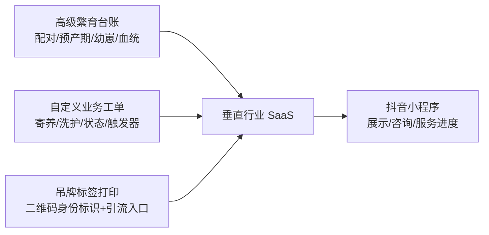

# 宠物商户数字化 SaaS — 产品介绍（融资版）

> 一句话介绍：**给猫舍、犬舍和宠物店用的"繁育台账 + 工单管理 + 宠物吊牌"数字化工具，靠 499 元硬件套餐获客，用抖音生态帮商家引流，再以增值服务持续变现。**
>
> 文档版本：2026-10-05｜配套文档：[prd.md](./prd.md)（产品需求）、[plan.md](./plan.md)（开发计划）
> 说明：标注「测算」的数字为内部估算，正式 BP 路演前需补充第三方行业报告引用。

---

## 1. 我们是谁

一家面向**宠物垂直商户**（猫舍、犬舍、宠物繁育基地、洗护 / 美容 / 寄养门店）的垂直 SaaS 服务商。

通用收银和会员系统服务的是"零售门店"，而宠物繁育与服务门店有三个被长期忽视的核心场景：

1. **繁育管理**——种公种母配对、预产期、幼崽登记、血统记录，目前绝大多数猫舍犬舍靠纸本和微信备忘录；
2. **服务过程透明化**——寄养 / 洗护期间，宠物主人最关心"我的宠物现在怎么样"；
3. **宠物身份标识与引流**——每只宠物需要可追溯到商家的二维码吊牌，扫码即进入商家私域。

我们用一套系统 + 一台标签打印机，把这三件事一次解决，并把商家自然带入抖音内容流量生态。

## 2. 市场机会

### 2.1 赛道背景（测算 / 待引用第三方报告核实）

- 中国宠物消费市场持续增长，城镇猫犬数量过亿只，宠物经济规模达数千亿元量级；
- 供给侧极度分散：全国宠物店、猫舍、犬舍数量以**十万家**计，单体规模小、数字化程度低，仍处于"微信群 + 纸本 + 通用收银"阶段；
- 抖音已成为宠物内容与本地生活服务的核心流量场，宠物店有强烈的"低成本获客"诉求，但绝大多数商家不具备技术对接能力。

### 2.2 为什么是现在

1. **供给端**：热敏打印硬件成熟、白标供应链（1688）价格下探到百元级，硬件 + SaaS 的入门套餐可以压到 499 元，决策门槛极低；
2. **流量端**：抖音小程序、短视频挂载、本地生活团购构成完整的"内容 → 到店"链路，中小商家自己接不进来，需要服务商；
3. **需求端**：后疫情时代繁育与洗护行业利润收窄，商家从"粗放经营"转向"要效率、要复购、要线上客流"。

## 3. 客户痛点

| 角色 | 现状痛点 |
|---|---|
| 猫舍 / 犬舍 | 繁育血统、配对、预产期全靠人脑和纸本；幼崽一多就乱；宠物没有统一身份标识，售后纠纷难举证 |
| 洗护 / 寄养店 | 寄养期间客户反复微信追问宠物状况，店员疲于拍视频回复；服务过程无标准记录 |
| 所有小店主 | 通用收银 / 会员系统不懂繁育和寄养场景；想做抖音引流但不会挂载、不会核销团购券 |
| C 端宠物主人 | 寄养时看不到宠物状态；买猫买狗缺少信息透明的商家入口，信任成本高 |

## 4. 产品与解决方案

### 4.1 产品形态（三端 + 硬件）

- **PC Web 后台（B 端）**：宠物档案、高级繁育台账、自定义业务工单、标签模板、抖音授权、增值服务；
- **抖音小程序（C 端）**：扫吊牌码看宠物详情 → 进入商家主页浏览全店宠物 → 咨询 / 查看寄养工单进度与服务影像；
- **Windows 打印助手 + 白标热敏标签打印机**：本地直连，一键打印含二维码的 PET 防水吊牌；
- **抖音生态联动**：商家发布挂载小程序的短视频引流；二期支持本地生活团购券"抖音下单 → 到店扫码核销 → 自动生成工单"。

### 4.2 基础版核心三角（免费软件的差异化壁垒）

通用收银系统做不了"繁育"，通用 CRM 做不了"吊牌打印 + 扫码引流"——三者合在一起构成只属于宠物垂直赛道的产品壁垒。

### 4.3 服务信任的解法

基础版中，店员在寄养 / 洗护工单里上传宠物照片和 10 秒短视频，C 端客户在小程序实时查看服务进度——以极低成本替代"实时摄像头"，同时自然形成向增值包（实时看宠）升级的转化钩子。

## 5. 商业模式

### 5.1 收入结构（四层收入）

| 层级 | 产品 | 价格 | 性质 |
|---|---|---|---|
| 获客层 | 打印机 + PET 贴纸硬件套餐 | 499 元 / 套 | 一次性收入，毛利率约 50%~65%（测算） |
| 复购层 | PET 防水标签贴纸 | 约 0.2 元 / 张 | 持续耗材复购 |
| 增值层 | 实时看宠摄像头增值包 | 99 元 / 月 或单路 199 元买断（待定） | 经常性收入 |
| 增值层 | 抖音团购核销插件、艺术二维码 / 高级模板、高级报表 / CRM | 订阅 / 按件付费 | 经常性收入 |

基础软件永久免费，降低获客阻力；**硬件赚第一笔钱，耗材和增值订阅赚长期的钱**。

### 5.2 单客户经济模型（示意，测算）

- 单套硬件毛利：约 250~350 元；
- 单店年均耗材：数百元量级（随出标签量增长）；
- 增值渗透率按个位数百分比保守估算，订阅 ARR 随租户规模线性增长；
- 极低的边际服务成本：纯软件交付 + 标准化安装视频，一个人即可服务大量租户。

### 5.3 获客方式

1. **种子商户地推**：前期以猫舍 / 洗护店样板客户打磨产品；
2. **租户裂变**：老商户生成专属邀请链接，平台以贴纸赠送 / 增值时长激励拉新；
3. **抖音内容自然流量**：商家发布挂载小程序的短视频，既是商家的获客渠道，也是平台品牌的免费曝光；
4. **硬件渠道**：与白标打印机供应商 / 宠物行业展会合作铺货。

## 6. 竞争与壁垒

| 对手类型 | 局限 | 我们的差异 |
|---|---|---|
| 通用收银 / 会员 SaaS | 只懂零售与储值卡，不懂繁育、寄养、宠物身份标识 | 垂直场景深度（繁育台账 + 自定义工单 + 吊牌） |
| 宠物店管理软件（传统单机版） | 老旧、无 C 端、无抖音生态、无硬件入口 | 云原生多租户 + 小程序 C 端 + 抖音流量闭环 |
| 摄像头 / 监控方案商 | 只卖硬件，无业务系统，无客户连接 | 摄像头只是增值项，业务系统与客户关系才是核心 |
| 商家自研 / 微信群 | 不可规模化、无标准 | 499 元开箱即用，免费软件零决策门槛 |

**壁垒沉淀路径**：商户使用越久，繁育记录、客户档案、工单历史、标签资产迁移成本越高 → 数据粘性；入驻商户越多，抖音侧内容与团购联动的网络效应越强 → 生态粘性。

## 7. 技术与交付

- 后端 Go（Gin + GORM）+ PostgreSQL **一租户一 Schema** 数据隔离 + Redis；React 管理后台；Taro(React) 抖音小程序；
- 对象存储 MinIO 自托管起步，单台服务器 Docker Compose 即可服务早期全部租户，**早期云成本极低（约 200~350 元 / 月，测算）**；
- 摄像头采用"链接透传、不做转码"的轻方案，不承担带宽重资产；
- 由具备全栈能力的独立开发者主导开发，MVP **10 周研发 + 4 周缓冲**即可交付试点（详见 [plan.md](./plan.md)），资金效率高。

## 8. 发展路线图

| 阶段 | 时间（自启动起） | 目标 |
|---|---|---|
| MVP | 第 1–3.5 月 | 多租户底座、繁育台账、工单引擎、标签打印、抖音小程序全链路；2~3 家种子商户真实开单 |
| 增值变现 | 第 4–8 月 | 抖音团购券核销插件、打印模板商店、实时看宠增值包、报表 / CRM；首批付费增值租户 |
| 规模扩张 | 第 9–18 月 | 租户裂变放量、硬件供应链标准化、跨租户运营大盘、双向同步团购套餐；探索微信小程序复用（Taro 一套代码） |

## 9. 融资需求

> 以下为待填项，路演前按实际方案补充。

- **拟融资金额 / 出让股份**：【待填】
- **资金用途（建议结构）**：
  - 产品研发（全职团队扩充：后端 / 前端 / 小程序）：约 50%；
  - 硬件首批备货与供应链：约 20%；
  - 商户地推与样板店打造：约 20%；
  - 合规资质（抖音服务商、类目、公司主体）与备用金：约 10%。
- **里程碑承诺**：融资到位后 6 个月内完成 MVP 上线 + 【X】家付费租户 + 增值模块商业化验证。

## 10. 团队

> 待补充：创始人 / 合伙人背景、宠物行业资源、供应链与抖音服务商资质进展。

## 11. 风险与应对（对投资人坦诚版）

| 风险 | 应对 |
|---|---|
| 抖音平台政策 / 类目准入变动 | 所有外部能力做适配层与功能开关；核心系统不依赖任何单一抖音能力即可独立使用；Taro 保留微信小程序备选 |
| 活体宠物类目敏感 | 一期严守"信息展示 + 咨询留资"，不做活体线上交易 |
| 打印机真机兼容 | W1 采购多机型真机验证，锁定单一交付机型，售后 SOP 化 |
| 增值转化率不确定 | 硬件 + 耗材本身已有毛利，增值是上行期权而非回本前提 |
| 早期团队精简 | 产品边界聚焦、MVP 范围克制；融资后优先补齐研发与地推人力 |

---

**联系方式**：【待填】
**一句话收尾**：我们卖的不是打印机，也不是软件——我们卖的是**让一家猫舍或宠物店"被看见、被信任、被复购"的数字化入场券**。
